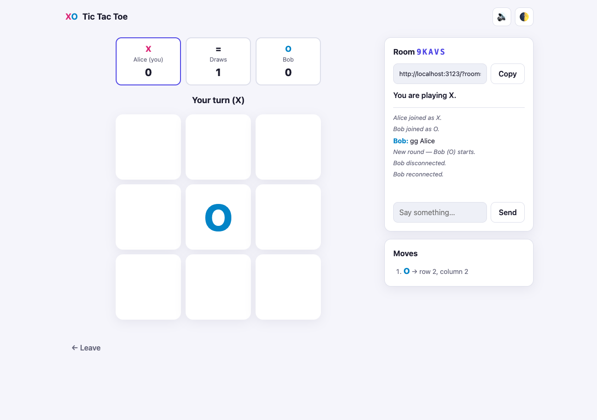
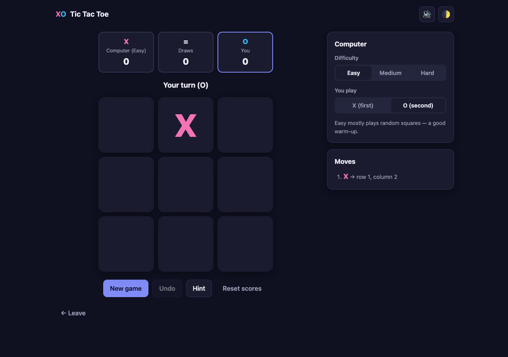

# Tic Tac Toe — Online PvP & Computer AI

A full-featured Tic Tac Toe web app with **online Player vs Player** over WebSockets and **Player vs Computer** powered by a minimax AI. It has no frontend framework and no build step. The only runtime dependency is [`ws`](https://github.com/websockets/ws).

| Online match | vs Computer (dark mode) |
| --- | --- |
|  |  |

## Features

**Player vs Player (online)**
- Create a private room with a 5-character code and a shareable invite link (`/?room=CODE`)
- Join by code, or use **Quick match** to pair with the next player waiting
- Server-authoritative game state: turns and moves are validated on the server, so clients can't cheat
- Live chat with system messages (joins, leaves, reconnects)
- **Reconnect support**: if you refresh or drop your connection, you get your seat back with the board and chat intact
- Spectators: a third person who opens the link watches live
- Rematches need both players to accept, and the starting player alternates each round
- Leaving mid-game counts as a forfeit, and the empty seat can be taken by a new opponent

**Player vs Computer (AI)**
- Three difficulty levels:
  - **Easy**: mostly random moves
  - **Medium**: always wins or blocks when it can, but can be beaten with a fork
  - **Hard**: full minimax with alpha-beta pruning. It cannot be beaten, and this is proven exhaustively in the tests.
- Play as X (first) or O (second)
- Undo (takes back your move and the computer's reply), plus a Hint that highlights the best move
- Scores are kept per difficulty and saved in `localStorage`

**Also included**
- Same-device pass-and-play mode
- Winning-line highlight, move history, scoreboard, and a turn indicator
- Light and dark theme (follows the system setting, with a manual toggle), sound effects with a mute button
- Keyboard play (keys `1`–`9`), accessible labels, a responsive layout that works on phones, and reduced-motion support

## Getting started

Requires Node.js 18+.

```bash
npm install
npm start            # http://localhost:3000  (set PORT to change it)
```

To try online mode on one machine, open the app in two browser tabs. Create a room in one tab, then paste the invite link into the other. To play from another device on your network, open `http://<your-LAN-IP>:3000`.

```bash
npm run dev          # restart on file changes
npm test             # unit + integration tests (node:test)
```

## Project structure

```
server.js            HTTP static server + WebSocket endpoint (/ws), heartbeat, cleanup
server/rooms.js      Room/seat/matchmaking logic (pure, unit-tested without sockets)
public/
  index.html         Single-page UI (home, online lobby, game screen)
  style.css          Theme tokens, light/dark, responsive layout
  js/game.js         Shared rules: win/draw detection, move validation (used by browser and server)
  js/ai.js           Minimax + alpha-beta, difficulty levels
  js/app.js          UI controllers for AI, local, and online modes; WebSocket client with auto-reconnect
test/                Rules, AI, room manager, and WebSocket integration tests
```

### WebSocket protocol

The client sends JSON messages to `/ws`:

| Message | Purpose |
| --- | --- |
| `{type:'create', name, clientId}` | Create a room and take seat X |
| `{type:'join', code, name, clientId}` | Join as O, reclaim your old seat, or watch as a spectator |
| `{type:'quick', name, clientId}` / `{type:'cancelQuick'}` | Enter or leave the matchmaking queue |
| `{type:'move', index}` | Place a mark (0–8) |
| `{type:'rematch'}` | Request or accept a rematch |
| `{type:'chat', text}` | Send a chat message (max 200 characters) |
| `{type:'leave'}` | Leave the room (counts as a forfeit if a game is in progress) |

The server replies with `state` (a full room snapshot for your role), `chat`, `queued`, `error`, `left`, and `kicked`. `clientId` is a random ID stored in `sessionStorage`, which lets a refreshed tab reclaim its seat.

## Deploying

Any host that runs Node.js and supports WebSockets will work, such as Render, Railway, Fly.io, or a VPS. Use `npm start` as the start command. The server reads `PORT` from the environment and exposes `/healthz` for health checks. GitHub Pages cannot host this app because online mode needs the Node server.

## License

MIT
